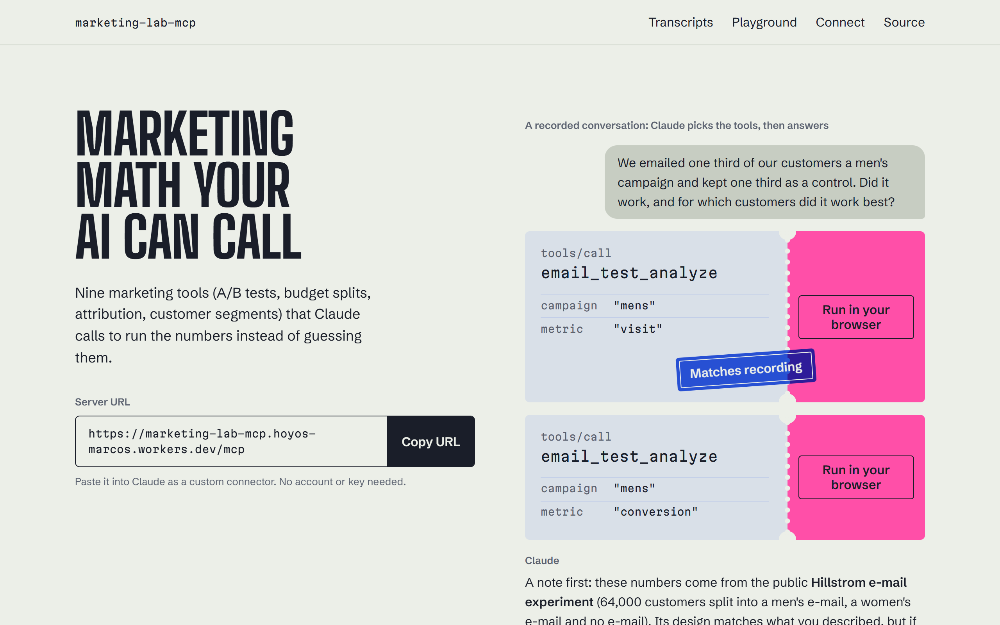

# marketing-lab-mcp

[](https://github.com/hysmarcos/marketing-lab-mcp/actions/workflows/ci.yml)

An MCP server with nine marketing tools (A/B tests, budget splits, attribution, customer segments) that Claude calls to run the numbers instead of guessing them. MCP (Model Context Protocol) is the standard way to give an AI like Claude tools. The tools work on public data, you can connect the server without an account, and hosting it costs nothing.

- **Demo:** https://hysmarcos.github.io/marketing-lab-mcp/
- **Server URL:** `https://marketing-lab-mcp.hoyos-marcos.workers.dev/mcp`

[](https://hysmarcos.github.io/marketing-lab-mcp/)

The demo page plays four conversations recorded with Claude Code. Every tool call in them has a "Run it live" button that runs the same call again, in your browser or on the public server, and checks the result against the recording.

## Try it in 30 seconds

In claude.ai (the free plan allows one custom connector):

1. Open **Customize → Connectors**.
2. Click **+ Add**, then **Add custom connector**.
3. Name it `marketing-lab`, paste `https://marketing-lab-mcp.hoyos-marcos.workers.dev/mcp` and click **Continue**.
4. Click **Continue** again, choose **No sign in** and click **Add**.

Then ask something like "Control: 500 of 10,000 converted. Variant: 570 of 10,000. Did it win?" Claude Desktop uses the same menu. The demo page also shows how to run the server locally and how to call it from the Claude API.

## The tools

| Tool                  | Question it answers                                                                                                                | Data                                                              |
| --------------------- | ---------------------------------------------------------------------------------------------------------------------------------- | ----------------------------------------------------------------- |
| `ab_test_evaluate`    | Did the variant win? Lift, confidence interval, p-value, Bayesian probability that B is better, and a sample ratio mismatch check. | Your counts                                                       |
| `ab_test_plan`        | How many visitors per group, and how many days, does a test need?                                                                  | Your baseline rate, effect and traffic                            |
| `email_test_analyze`  | Did an e-mail campaign change visits, conversions or spend, and for which customers?                                               | Hillstrom e-mail experiment (64,000 customers)                    |
| `budget_simulate`     | How much media-driven sales would this weekly split bring, with a range?                                                           | Bayesian MMM fitted on Robyn's simulated data                     |
| `budget_optimize`     | What split of a weekly budget sells the most, within limits per channel?                                                           | Same model                                                        |
| `store_sales`         | Which categories, states or months drive revenue, reviews and late deliveries?                                                     | Olist e-commerce (96,000 delivered orders)                        |
| `customer_rfm`        | Which customers are loyal, new, or about to leave?                                                                                 | Olist, or your own customer list (capped)                         |
| `lead_funnel`         | Which channel brings leads that close, and how fast?                                                                               | Olist marketing funnel (8,000 leads)                              |
| `attribution_compare` | How much credit does each channel get under last touch, first touch, linear, Markov and Shapley?                                   | Simulated journeys with a known truth, or your own paths (capped) |

Every tool validates its input with a zod schema and says what to fix when something is wrong. Each answer has a short summary for the model and the full numbers as structured content.

On the simulated journeys, `attribution_compare` scores each model against the truth the simulator knows. Last touch is clearly the worst. First touch, Shapley and linear come closest, and Markov sits in between. That ranking comes from how this simulator builds journeys, so it is not a general rule.

## How it works

One `createServer()` call builds the MCP server and its nine tools. Three runtimes wrap that same server in a different transport, so a tool gives the same answer wherever it runs.

```
data/*.json  ─┐
              ├─ src/core/    pure calculations, no network
              └─ src/server/  createServer(): the McpServer with the nine tools
                     ├─ Browser: the demo page's playground (in-memory transport)
                     ├─ Cloudflare Worker: public /mcp URL (Streamable HTTP, stateless)
                     └─ Local: stdio (Node)
```

- The data ships inside the bundle as small JSON summaries. Heavy work happens ahead of time in `prep/` (Python), so each call stays under the Workers limit of 10 ms of CPU.
- The Worker keeps no state: no database, no KV store, no secrets at run time.
- The recorded conversations are JSON files in `site/transcripts/`. The tests re-run every recorded call and check that the output still matches.

## Data and licenses

| Data                                 | Source                                                                                                              | License                                                                           |
| ------------------------------------ | ------------------------------------------------------------------------------------------------------------------- | --------------------------------------------------------------------------------- |
| `hillstrom_cells.json`               | Kevin Hillstrom, MineThatData E-Mail Analytics Challenge (2008)                                                     | None stated. Only aggregated counts and sums are kept, with credit to the source. |
| `mmm_results.json`                   | [marketing-mix-model](https://github.com/hysmarcos/marketing-mix-model), fitted on Meta Robyn's simulated demo data | MIT                                                                               |
| `olist_sales.json`, `olist_rfm.json` | Olist, Brazilian E-Commerce Public Dataset, Kaggle                                                                  | CC BY-NC-SA 4.0                                                                   |
| `olist_funnel.json`                  | Olist, Marketing Funnel by Olist, Kaggle                                                                            | CC BY-NC-SA 4.0                                                                   |
| `journeys_sample.json`               | Generated by `prep/journeys.py` with a fixed seed                                                                   | MIT                                                                               |

The repository holds only these summaries, never the raw datasets. [`data/README.md`](data/README.md) has the full sources, what each summary keeps and the command that rebuilds it. The code is MIT. The three Olist files are derived from CC BY-NC-SA 4.0 data, so they stay under that license (non-commercial, share-alike).

## Why it costs $0 to run

| Piece                    | Where                         | Free limit                                       |
| ------------------------ | ----------------------------- | ------------------------------------------------ |
| Demo page and playground | GitHub Pages                  | 1 GB site, 100 GB a month of traffic             |
| Public `/mcp` URL        | Cloudflare Workers, free plan | 100,000 requests a day, 10 ms of CPU per request |
| CI                       | GitHub Actions                | Free for public repositories                     |

- The server never calls a model. Each visitor's own Claude account pays for the conversation, and the demo page plays recordings instead of calling the Claude API.
- The Worker deploys with `npx wrangler deploy`. On the free plan, if traffic passes the daily limit, Cloudflare stops serving requests until the next day. It never bills.
- If the Worker is down, the demo page still works: it runs the tools in the browser.

## Local development

You need Node.js 24 and, to rebuild the data, [uv](https://docs.astral.sh/uv/).

```sh
npm ci
npm test                      # vitest: core math, MCP contract, Worker, page
npm run start:stdio           # the server over stdio, for a local MCP client
npx vite build                # the demo page, into site/dist
npx wrangler dev              # the Worker on localhost

uv sync
uv run pytest prep -m "not raw"
uv run python -m prep hillstrom olist funnel journeys   # rebuilds data/*.json
uv run python -m prep reference                         # rebuilds the A/B test fixture
```

The `prep` commands download the public datasets once to `.cache/raw/` (ignored by git). `mmm_results.json` is a fixed copy from the source project, so no command here rebuilds it.

Tests check the core math against reference values from scipy and statsmodels, and the budget tools against the Python model they port. CI runs lint, type checks, the Python and TypeScript tests, and builds the page and the Worker on every push.

## How it compares

A survey of public marketing MCP servers on 2026-10-31 found three groups:

| Group                       | Examples                                       | What they lack                                                                                     |
| --------------------------- | ---------------------------------------------- | -------------------------------------------------------------------------------------------------- |
| Vendor servers              | GA4, Google Ads, Meta Ads, Klaviyo, HubSpot    | All need an account. None has a public demo.                                                       |
| MMM servers                 | `mcp-server-meridian`, `pymc-marketing-mcp`    | You install Python and bring a trained model. No demo.                                             |
| Calculators with no account | `aaj-engines`, `abtestresult-mcp`, `rigor-mcp` | Mostly A/B tests only. No playground. `aaj-engines` hides 66 calculations behind one generic tool. |

What this project adds: multi-touch attribution (Markov and Shapley) as an MCP tool, one typed tool per decision, real public data, a browser playground that runs the same code as the server, recorded conversations you can re-run, and visible tests and CI.

Where it falls short: it has fewer calculations than `aaj-engines`, and it does not train a marketing mix model. The budget tools read one model fitted elsewhere on simulated data, so they show how the analysis works, not what your channels do.

## En español

MCP (Model Context Protocol) es la forma estándar de darle herramientas a una IA como Claude. marketing-lab-mcp es un servidor MCP con nueve herramientas de marketing: tests A/B, reparto de presupuesto, atribución y segmentos de clientes. Claude las usa para hacer las cuentas en lugar de adivinarlas.

- Probalo en la página: https://hysmarcos.github.io/marketing-lab-mcp/
- Para usarlo en claude.ai, agregá un conector personalizado con esta URL: `https://marketing-lab-mcp.hoyos-marcos.workers.dev/mcp`. El plan gratis también lo permite.
- Los datos son públicos (Hillstrom, Olist) o simulados (Robyn y los recorridos de atribución). No son datos de una empresa real.
- La página está en GitHub Pages y el servidor está en el plan gratis de Cloudflare Workers. Mantenerlo no cuesta nada.

## License

Code: MIT, see [LICENSE](LICENSE). Data files: see [Data and licenses](#data-and-licenses).
